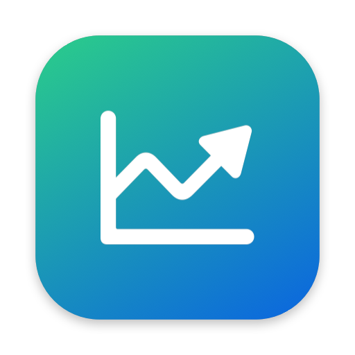

<div align="center">



# Мониторинг цен

**Цены конкурентов на технику Samsung — в вашу Excel-таблицу за один запуск**

М.Видео · DNS · МТС · samsungstore · Ozon · Wildberries

[](https://github.com/romanovevgeniy/monitoring-prices/actions/workflows/build.yml)

### [⬇ Скачать для Windows](https://github.com/romanovevgeniy/monitoring-prices/releases/latest/download/MonitoringPrices-Windows-Setup.exe) &nbsp;·&nbsp; [⬇ Скачать для Mac](https://github.com/romanovevgeniy/monitoring-prices/releases/latest/download/MonitoringPrices-macOS.dmg)

<sub>Все версии и что в них нового — на странице <a href="https://github.com/romanovevgeniy/monitoring-prices/releases">Releases</a></sub>

</div>

---

## Что делает

- **Заполняет таблицу мониторинга** ценами магазинов: ТВ и саундбары, смартфоны, планшеты, часы, наушники.
- **Подсвечивает красным**, где конкурент дешевле НОСИМО, и снимает старую подсветку, если уже нет.
- **Сам подбирает ссылки** на товары (М.Видео, DNS, МТС, samsungstore) и обновляет их, когда предложения меняются.
- **Не сдаётся на антиботе**: повторяет неудавшиеся артикулы в конце прогона, а если сайт просит пройти проверку — выводит Chrome вперёд и подаёт сигнал.
- **Не трогает оформление**: шрифты, цвета, рамки, форматы «₽» остаются как были, меняются только цены.
- **Складывает всё по полочкам**: таблицы, ссылки, скриншоты и логи — в одной папке, по датам.

## Установка

Нужен **Google Chrome**: программа открывает в нём сайты магазинов (Ozon и Wildberries пропускают только «настоящий» браузер).

<table>
<tr><th width="50%">Windows 10 / 11</th><th>macOS 26 и новее (Apple Silicon)</th></tr>
<tr valign="top"><td>

1. Скачайте [`MonitoringPrices-Windows-Setup.exe`](https://github.com/romanovevgeniy/monitoring-prices/releases/latest/download/MonitoringPrices-Windows-Setup.exe) и запустите.
2. Если Windows покажет «Windows защитила ваш компьютер» — **Подробнее → Выполнить в любом случае** (у программы нет платной цифровой подписи).
3. С **Kaspersky** и похожими антивирусами добавьте папку программы в исключения — иначе он может заблокировать её файлы, и программа не запустится.

</td><td>

1. Скачайте [`MonitoringPrices-macOS.dmg`](https://github.com/romanovevgeniy/monitoring-prices/releases/latest/download/MonitoringPrices-macOS.dmg), откройте и перетащите «Мониторинг цен» в «Программы».
2. При первом запуске macOS скажет, что не может проверить разработчика: **Системные настройки → Конфиденциальность и безопасность → «Всё равно открыть»** (у программы нет подписи Apple).

</td></tr>
</table>

## Как пользоваться

1. **Первый запуск** — программа спросит, где создать **основную папку**. Дальше всё складывается туда.
2. **Выберите таблицу** мониторинга (тип — ТВ или Смартфоны — определится сам) и отметьте магазины.
3. **Ссылки** — для новых моделей нажмите «Заполнить автоматически».
4. **Цены НОСИМО** — кнопкой (с galaxystore.ru) или вручную из 1С.
5. **Запустить** — откроется Chrome, не закрывайте его. Прогресс по каждому магазину и найденные цены видны в окне.

Подробное руководство — кнопка **«Справка»** в программе ([`docs/guide.html`](docs/guide.html)).

### Основная папка

```
Мониторинг цен/
├── Таблицы/               ← ваши таблицы ТВ и смартфонов
├── Ссылки/                ← links_tv.xlsx, links_smart.xlsx — правятся здесь
└── 2026-10-22/            ← папка дня
    ├── ТВ/                ← таблица ТВ с ценами
    ├── Смартфоны/         ← таблица смартфонов с ценами
    ├── Ссылки/            ← копия ссылок, по которым собраны цены этого дня
    ├── Скриншоты/         ← ТВ.png, Смартфоны.png
    └── Логи/              ← что, где и почему найдено
```

## Правила сбора

| Магазин | Как берётся цена |
|---|---|
| М.Видео, DNS, МТС, samsungstore | по ссылке из файла ссылок; карточка проверяется: ТВ — по артикулу, смартфоны — по модели, памяти и связи из «Наименования» |
| Ozon | первые 15 карточек поиска по артикулу: самая низкая цена **с Ozon-картой** среди товаров с отзывами (отзывов нет — самая низкая); без уценки и зарубежных |
| Wildberries | первые 15 карточек: самая низкая цена среди товаров с отзывами (отзывов нет — самая низкая) |
| НОСИМО | кнопка «Цены НОСИМО» (galaxystore.ru; нет в наличии — цена всё равно, нет на сайте — «-») или из 1С |

**Автозаполнение ссылок.** ТВ — М.Видео (самая дешёвая карточка в наличии) и DNS. Смартфоны — самый дешёвый цвет в наличии; на М.Видео сначала карточка самого магазина, иначе самый дешёвый продавец маркетплейса **без зарубежных версий**. Перед каждым сбором цен по смартфонам ссылки М.Видео обновляются автоматически.

**Обозначения.** «-» — нет в наличии. Ошибка сайта (антибот, таймаут) — в конце прогона программа ещё дважды проходит по таким артикулам; не вышло — в ячейке остаётся прежнее значение. Если сайт показал проверку антибота, окно Chrome выходит вперёд, а приложение подаёт сигнал: проверку можно пройти вручную. **Красный** — цена конкурента ниже НОСИМО.

---

<details>
<summary><b>Для разработки</b></summary>

### Запуск из исходников

```bash
python3 -m venv .venv && .venv/bin/pip install -r requirements.txt

.venv/bin/python run.py --file ~/Desktop/ТВ.xlsx --root ~/Documents/Мониторинг\ цен   # как в приложении
.venv/bin/python run.py --file ТВ.xlsx --root … --stores wb,ozon --articles UE32H5000FUXRU
.venv/bin/python fill_links.py --file Смартфоны.xlsx --root …                         # --stores mvideo — только М.Видео
.venv/bin/python nosimo.py --file ТВ.xlsx                                             # цены НОСИМО с galaxystore.ru
```

`run.py --no-links-refresh` — не обновлять ссылки М.Видео перед смартфонами; без `--root` результат пишется в `results/`.

### Сборка и релиз

- **Релиз**: `git tag v1.2.0 && git push origin v1.2.0` — GitHub Actions ([`build.yml`](.github/workflows/build.yml)) соберёт оба установщика, проверит запуск и опубликует их на странице релиза. Описание релиза — `.github/release-notes/<тег>.md`.
- **Проверочная сборка** без релиза: Actions → «Сборка» → Run workflow (файлы — в Artifacts).
- **Локально**: Mac — `./build_dmg.sh` → `dist/Мониторинг цен.dmg`; Windows — `powershell -ExecutionPolicy Bypass -File build_windows.ps1` (Python 3.12 + Inno Setup 6).

### Файлы

| | |
|---|---|
| `run.py` | сбор цен; `stores.py` — магазины; `excel.py` — запись в таблицу; `matching.py` — артикулы ТВ |
| `fill_links.py`, `phone_sites.py`, `phone_matching.py` | автозаполнение ссылок; `make_links_template.py` — синхронизация файла ссылок с таблицей |
| `layout.py` | основная папка: где таблицы, ссылки, папки дней; перенос прежних файлов ссылок |
| `config.py` | таблицы (колонки, заголовки), правило подсветки |
| `nosimo.py` | цены НОСИМО; `screenshot.py`, `excel_html.py` — скриншот таблицы |
| `app/` | приложение для Mac (SwiftUI) |
| `desktop_app.py` | приложение для Windows (Qt); `tools_main.py` — вход скриптов в собранных версиях; `paths.py` — служебные файлы |
| `build_dmg.sh`, `build_windows.ps1`, `installer.iss` | сборка установщиков |

</details>
